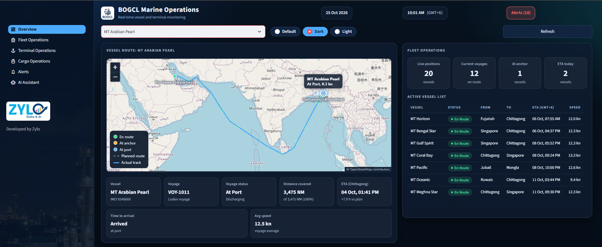

# BOGCL Marine Operations

**A unified operational view of fleet, terminal, cargo, and marine activity.**

[Open Live Dashboard](https://bogcl-ops-app-cknak4cvpvpbtabrpyprmt.streamlit.app/) · [GitHub Repository](https://github.com/RaihanKabir277/bogcl-ops-streamlit)

---

## Dashboard Preview


(assets/dashbaord_preview2.png)
(assets/dashbaord_preview3.png)
## Overview

BOGCL Marine Operations is a Streamlit dashboard that brings key marine operations views together in one interface.

## Features

- **Overview** — high-level operational summary
- **Fleet Operations** — fleet information
- **Terminal Operations** — terminal activity
- **Cargo Operations** — cargo information
- **Alerts** — operational alerts
- **AI Assistant** — an interface for operational questions

## Run Locally

Clone the repository:

```bash
git clone https://github.com/RaihanKabir277/bogcl-ops-streamlit.git
cd bogcl-ops-streamlit
```

Install dependencies:

```bash
pip install -r requirements.txt
```

Launch the dashboard:

```bash
streamlit run streamlit_app.py
```

## Project Structure

```text
.
├── streamlit_app.py
├── views.py
├── theme.py
├── data.py
├── components.py
├── assets/
└── docs/
    └── dashboard-preview.png
```

## Deployment

The live dashboard is hosted on Streamlit Community Cloud.

**[Launch BOGCL Marine Operations](https://bogcl-ops-app-cknak4cvpvpbtabrpyprmt.streamlit.app/)**

## Security

Keep credentials and private configuration out of source control. Use Streamlit secrets or environment variables for sensitive values.

---

*BOGCL Marine Operations · Streamlit Dashboard*
